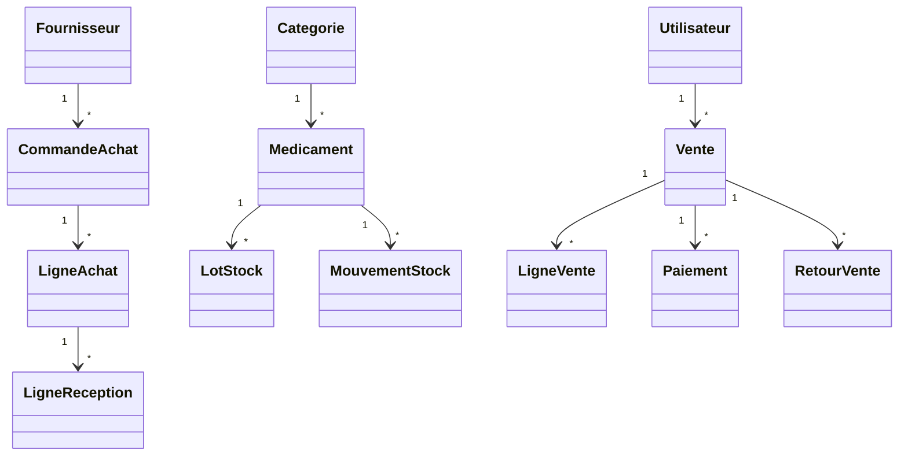

# Dossier de conception — PharmaGest

## Architecture

Django suit le modèle MVT : les modèles portent les données et règles, les vues contrôlent les opérations et permissions, les templates présentent l'interface. Les services `services.py` regroupent les opérations transactionnelles de réception, vente et inventaire.

## Entités principales

- Utilisateur : compte Django, rôle et téléphone.
- Categorie 1—N Medicament.
- Medicament 1—N LotStock.
- Fournisseur 1—N CommandeAchat.
- CommandeAchat 1—N LigneAchat ; LigneAchat 1—N LigneReception.
- ReceptionAchat 1—N LigneReception.
- Medicament et LotStock sont référencés dans MouvementStock.
- Vente 1—N LigneVente et Vente 1—N Paiement.
- Vente 1—N RetourVente ; chaque retour référence une ligne d'origine.
- Utilisateur est associé aux ventes, achats, réceptions, mouvements et journaux.

## Règles de stock

Une commande n'impacte jamais le stock. La réception validée crée/actualise un lot et un mouvement d'entrée. La vente consomme les lots non bloqués et non périmés, triés par date de péremption (FEFO), dans une transaction atomique. Les quantités négatives et ventes au-delà du stock disponible sont refusées. Les prix appliqués sont copiés dans les lignes de vente.

## Diagramme de classes simplifié

## Matrice indicative des rôles

| Fonction | Admin | Pharmacien | Stock | Caissier | Gestion |
|---|---:|---:|---:|---:|---:|
| Catalogue | Oui | Oui | Lecture | Lecture | Lecture |
| Achats / réceptions | Oui | Oui | Oui | Non | Lecture |
| Vente / caisse | Oui | Oui | Non | Oui | Lecture |
| Rapports | Oui | Oui | Non | Non | Oui |
| Utilisateurs / audit | Oui | Non | Non | Non | Non |

Les permissions doivent être affinées selon la politique de l'établissement.
